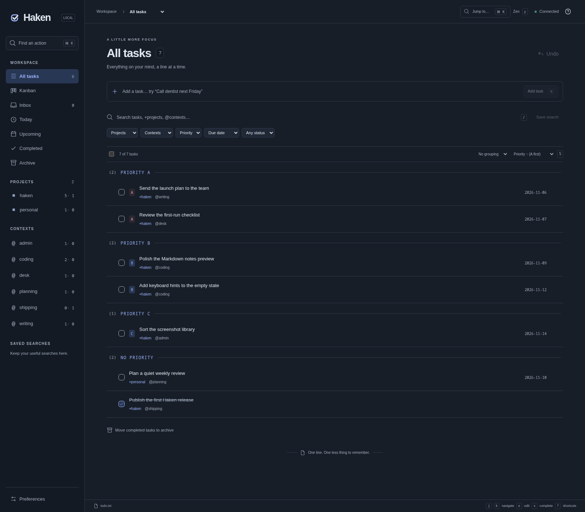
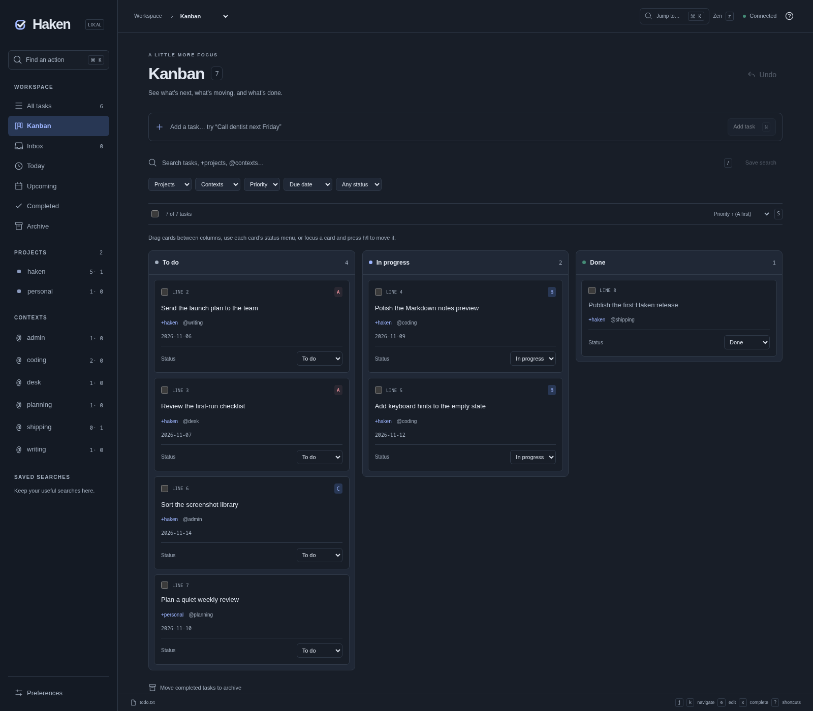

<div align="center">
  
  <p><strong>A keyboard-first home for your tasks.</strong><br />A focused todo.txt workspace with projects, contexts, Markdown notes, and Kanban.</p>

  <a href="https://github.com/MBeggiato/haken/stargazers"></a>
  <a href="https://github.com/MBeggiato/haken/network/members"></a>
  <a href="https://github.com/MBeggiato/haken/issues"></a>
  <a href="https://github.com/MBeggiato/haken/commits/main"></a>
</div>

## Screenshots

| Task list | Kanban board |
| --- | --- |
|  |  |

## What is Haken?

Haken is a local-first task manager built around the plain-text [todo.txt format](https://github.com/todotxt/todo.txt). It keeps task data portable while adding a fast, keyboard-driven interface for planning and review.

- **Keyboard-first workflow:** Vim-inspired navigation, persistent view switching, command palette, and a modal task editor.
- **List and Kanban:** Work from a task list or move cards between To do, In progress, and Done.
- **Useful task organization:** Priorities, due dates, recurrence, projects, contexts, saved searches, and combined filters.
- **Notes and images:** Link Markdown notes to tasks, preview formatted notes, and paste or drop images.
- **Pocket ID sign-in:** Each account gets its own task files, notes, and images.
- **Plain files, no database:** Haken reads and writes todo.txt files while preserving unrelated lines and metadata.

## Get started

Requirements: Node.js 22.12 or newer and npm.

```sh
git clone https://github.com/MBeggiato/haken.git
cd haken
npm install
cp .env.example .env
```

Set your Pocket ID client details in `.env`, then start the development server:

```sh
npm run dev
```

Open [http://127.0.0.1:3000](http://127.0.0.1:3000) and sign in with Pocket ID.

### Pocket ID setup

Register Haken as an OIDC client in Pocket ID. Set its redirect URI to the exact value of `POCKETID_REDIRECT_URI`, which defaults to:

```text
http://127.0.0.1:3000/auth/callback
```

Required `.env` settings:

```dotenv
POCKETID_ISSUER=https://id.example.com
POCKETID_CLIENT_ID=haken
POCKETID_CLIENT_SECRET=your-client-secret
POCKETID_REDIRECT_URI=http://127.0.0.1:3000/auth/callback
```

Optional settings include `POCKETID_ALLOWED_EMAILS` (comma-separated allowlist), `DATA_DIR` (defaults to `./data`), `HOST` (defaults to `127.0.0.1`), and `PORT` (defaults to `3000`). Keep `.env` private. Use HTTPS when serving Haken beyond localhost.

Each Pocket ID account receives an isolated directory under `DATA_DIR/users/`. On a fresh install, the first account receives a copy of any existing single-user task files and notes; later accounts start with empty workspaces. Original files are retained.

## Keyboard essentials

| Key | Action |
| --- | --- |
| `j` / `k` | Move through tasks |
| `n` | Create a task |
| `e` / `Enter` | Edit the focused task |
| `R` | Rename task text |
| `x` | Complete or reopen task |
| `h` / `l` on Kanban | Move a card between lanes |
| `g` | Enter view-selection mode; `Esc` or `:q` cancels |
| `/` | Search tasks |
| `S` | Cycle task sort order |
| `Ctrl/⌘+K` or `:` | Open the command palette |
| `?` | Show shortcut help |

The editor supports Vim-style Normal and Insert modes, plus quick keys for rescheduling, priority, project, and context changes. See the in-app shortcut guide for the full list.

## Development

```sh
npm run check   # Svelte and TypeScript checks
npm test        # Automated tests
npm run build   # Production build
npm start       # Run the production server (after building)
```

Haken serves the frontend and API from one Node.js process. Task files and notes live under `DATA_DIR`; back up that directory with your usual filesystem backup tools.
